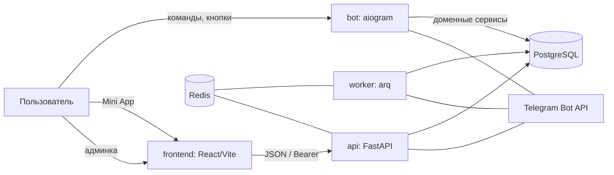

# Тезис — техническая архитектура

## 1. Принципы

1. **Модульный монолит, три процесса.** Бот, API и фоновый воркер используют один доменный слой и одну базу. Это дешевле в эксплуатации на ранней стадии, чем микросервисы, но границы модулей сохраняют возможность разделения позже.
2. **PostgreSQL — источник истины.** Redis используется только для кеша, rate limit и очереди arq. Если Redis недоступен, данные заказов и платежей не теряются.
3. **Идемпотентность на границах.** Создание заказа, подтверждение платежа, начисление реферального вознаграждения и доставка цифрового товара защищены уникальными ключами в БД.
4. **Никаких карточных данных.** Основной способ оплаты — Telegram Stars. Реквизиты выплат хранятся как текст и не являются платёжными картами.
5. **Провайдер AI за интерфейсом.** Локально и в тестах работает детерминированный `mock`; при наличии ключа подключается OpenAI-совместимый провайдер.

## 2. Компоненты

### `bot`
- aiogram 3, Dispatcher, FSM, middlewares.
- Команды: `/start`, `/menu`, `/profile`, `/shop`, `/balance`, `/referral`, `/support`, `/help`, `/subscription`.
- Отвечает за диалог, invoice Stars и обработку `pre_checkout_query` / `successful_payment`.
- Не содержит бизнес-правил напрямую — вызывает `app.services.*`.

### `api`
- FastAPI, `/api/v1`, OpenAPI на `/docs`.
- Публичные: health, catalog.
- Авторизация: `POST /auth/miniapp` (initData), `/auth/telegram` (Login Widget), `/auth/dev` (только dev).
- Пользовательские: `/me`, `/orders`, генерации, `/me/chat` (GET/POST/DELETE), рефералы, выплаты, поддержка.
- Админские: `/admin/*` с RBAC (`manager`, `admin`, `owner`).
- Webhook Telegram под `/api/v1/webhooks/telegram/{secret}`.

### `worker`
- arq, cron:
  - `expire_subscriptions` — каждые 5 минут;
  - `retry_deliveries` — каждые 30 минут;
  - `send_scheduled_broadcasts` — каждый час;
  - `cleanup_stale_payments` — каждые 30 минут;
  - `cleanup_generation_history` — каждые 12 минут, удаляет генерации и сообщения чата старше `GENERATION_HISTORY_DAYS` (по умолчанию 30 дней).
- Все задачи идемпотентны и писают аудит/события где это нужно.

### `frontend`
- React 19 + Vite + TypeScript + Tailwind.
- Два входа: `/admin` (админка) и `/app` (Mini App).
- Любой токен хранится в `localStorage`; production использует проверенный `initData`.

## 3. Доменные модули

| Модуль | Ответственность |
| --- | --- |
| `users` | Создание пользователя Telegram, роли, профиль, last_seen |
| `settings` | Ключ-значение настроек продукта, изменимые из админки |
| `catalog` | Активные товары, цены в ₽ и Stars, цифровые файлы |
| `orders` | Корзина/заказ, snapshot позиций, idempotency key, отмена |
| `payments` | Stars, manual/dev, refund, уникальность внешних ID |
| `subscriptions` | Лимиты, периоды, продление, истечение подписок |
| `ai` | Провайдер, промпты, генерация, история, учёт стоимости |
| `chat` | История чата, ответы помощника, списание квоты, активация бонуса |
| `websearch` | Реальный поиск (Tavily/Serper/свой SearXNG) или демо-база знаний без ключа |
| `referrals` | Привязка реферера, бонус 25 ₽ за первого друга, баланс, выплаты |
| `delivery` | Доставка цифровых товаров, повторные попытки |
| `community` | Выдача/отзыв доступа к закрытому чату |
| `notifications` | Уведомления пользователям и команде |
| `broadcasts` | Сегменты, отложенная отправка, учёт доставок |
| `support` | Тикеты и ответы |
| `analytics` | Дашборд, MRR, прибыль, события |
| `audit` | Журнал административных действий |

## 4. Ключевые сценарии

### Покупка за Stars
1. Пользователь выбирает товар -> `POST /orders` или кнопка бота.
2. Заказ получает статус `pending`; в `order_items` сохраняется снимок цены.
3. `POST /orders/{id}/pay/stars` создаёт invoice через Bot API и возвращает `invoice_url`.
4. Telegram вызывает webhook/пре-чекаут; сумма в Stars сверяется с `order.total_stars`.
5. `successful_payment` -> `payments.confirm_stars_payment`:
   - уникальный `telegram_charge_id` защищает от повтора;
   - заказ -> `paid`;
   - для подписки создаётся/продлевается `Subscription`;
   - запускается доставка и доступ в клуб.
   Реферальный бонус начисляется отдельно — по первому запросу друга.
6. Worker повторяет неудавшуюся доставку.

### Реферальная программа
- `/start ref_<code>` или `?startapp=ref_<code>` вызывает `referrals.capture_referral`.
- Самоприглашение и повторная привязка игнорируются.
- За первого друга, сделавшего первый запрос в чате или студии, начисляется 25 ₽ (`referral_bonus_minor=2500`).
- Уникальность `ReferralEarning.referee_id` исключает двойное начисление за одного друга.
- Исторические начисления по оплатам остаются в БД как `source='order'`; новые по ним не создаются.
- Выплата создаётся только от 1000 ₽ и вручную одобряется администратором.

### Лимиты Neurons
- Без подписки: `free_neurons` (по умолчанию 500) на весь срок действия аккаунта, без обновления.
- С подпиской: `neurons_per_week` из тарифа — 500 / 1000 / 2500. Лимит пополняется каждые 7 дней (`SUBSCRIPTION_PERIOD_DAYS`) в окне `current_period_start` … `current_period_end`, пока подписка активна. При продлении того же тарифа сдвигается срок, недельная норма не суммируется.
- Per-user `neurons_bonus` и `neurons_limit_override` корректируют лимит; владелец меняет тарифы в «Товарах», а отдельную подписку — в «Подписках» админки.
- Счётчиков генераций нет: расход считается в `usage_events` по Neurons. История генераций хранится `GENERATION_HISTORY_DAYS` (30 дней), затем воркер удаляет старые записи; учёт токенов и стоимости остаётся в `usage_events`.

## 5. Безопасность

- `initData` проверяется HMAC-SHA256 по токену бота с TTL `auth_date`.
- Telegram Login Widget проверяется по SHA256(token) как ключ подписи.
- JWT HS256, TTL 12 часов; role проверяется на каждом запросе, а не только в UI.
- Пароли — PBKDF2-HMAC-SHA256 с солью; dev-логин выключен в `APP_ENV=prod`.
- Rate limit: Redis, для авторизации/генераций/создания заказов.
- Webhook защищён секретом в пути.
- Админские действия пишутся в `audit_log` с IP и payload.
- Секреты только в `.env`, который не попадает в репозиторий и Docker image.

## 6. Хранение и конфигурация

- Локально: SQLite + mock AI + dev payments — без Docker.
- Prod: PostgreSQL 16 + Redis 7 + Caddy (TLS) + три процесса приложения.
- Миграции: Alembic; в prod `AUTO_CREATE_TABLES=false`.
- Цифровые товары лежат в `backend/assets/products`, монтируются в контейнеры только на чтение.
- Бэкапы: `scripts/backup.sh` (pg_dump + assets + 14 дней ретенции).

## 7. Известные ограничения MVP

- Нет автоматической публикации в соцсети и white-label.
- Выплаты рефералам обрабатываются вручную; автоматические переводы не реализованы.
- YooKassa не подключена как активный адаптер — оставлен только Stars и тестовая оплата.
- Один язык интерфейса (русский) и одна валюта ценообразования (RUB + Stars).
- Локальная проверка Docker на машине разработки не выполнялась: в окружении нет Docker/Git.
